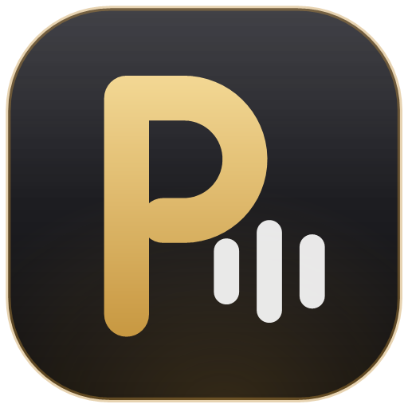

# Prosper Voice for Windows

Prosper's voice features on a PC: dictation into any app, spoken edits of selected text, and an Assistant that sees
your selection and, when you ask, your screen. It's one small `.exe` (about 130 KB) for Windows 10 and 11. Nothing is
installed and no admin rights are needed: copy it to the laptop and run it.

## Use

| | Prosper bar | Shortcut |
|---|---|---|
| Dictate into the app you're typing in (click again to stop) | click | Ctrl+Alt+Space |
| Assistant: ask for an email, a reply, an answer… | double-click | Ctrl+Alt+A |
| Type to the Assistant about the selected text (no talking) | hover, then **Type** | Ctrl+Alt+T |
| Add the screen to the Assistant request | **Add screen** in the bar | Ctrl+Alt+S |
| History and follow-up chat | hold | Ctrl+Alt+H |
| Menu: settings, Focus, hide the bar when idle, quit | right-click | |
| Focus: open the timer controls | click the taskbar timer | Ctrl+Alt+F |
| Focus: meeting mode on or off | **Meeting** in the timer controls | Ctrl+Alt+M |

Every shortcut can be changed in *Settings → Shortcuts*: click one and press the keys you want (Backspace turns it
off). Prosper says straight away if another app or another Prosper action already uses them.

**The Prosper bar** is a small frosted-glass pill at the bottom centre of the screen; drag it anywhere. At rest it is a
thin sliver with a gold dot; hovering shows *Click to talk* and a **Type** button. While you talk it opens into **✕ cancel · timer · live
waveform · ✓ finish**. The waveform follows your voice: tall while you speak, flat in pauses, and it adjusts to quiet
mics by itself. In Assistant mode the bar gets a gold edge, a ✦ and an **Add screen** button. While Prosper works,
the bar says what it is doing ("Transcribing", "Thinking with your screen"), then confirms ("Typed · copied").
`ProsperVoice.exe --preview` plays through every state with your real microphone level and no API calls, then every
Focus state with a made-up block. It can run beside your real Prosper and touches none of your data.

- **Dictation** is transcribed, cleaned up (no ums, proper punctuation) and pasted where the cursor is.
- **With text selected**, what you say is an instruction for that text ("make this formal", "translate to Hindi"),
  and the result replaces the selection.
- **The Assistant** writes what you ask for. It gets your request, the selected text, the app's name, *About you*
  from settings, and the screen if you clicked **Add screen**. If a text field has focus, the answer is typed
  there; otherwise it opens in a card with Insert, Copy and Open chat. Every answer is also copied.
- **Typing instead of talking** (an open office, a meeting): select text, hover the bar and click **Type**, or press
  Ctrl+Alt+T. A small box opens above the bar with the selection, quick actions (Fix grammar, Shorter, More formal,
  Reply to this) and a line to type what you want. The answer shows in the box first and is copied: **Replace
  selection** (Ctrl+Enter) puts it in the app, or type again to refine it ("shorter", "in Hindi"). If the Assistant
  needs something only you know, such as who a reply is for, it asks one short question there instead of guessing; a
  voice request that needs an answer opens the same box. Esc or clicking elsewhere closes it.
- **History** keeps every conversation: what you said, the screenshot, the answer, and each tool call. You can type
  or speak follow-ups there, or attach an audio file (📎, up to 25 MB) to get its transcript or ask about it.
- **MCP (optional, off until you connect a server)**: in settings, enter a server URL and then either *Sign in*
  (OAuth, in your browser) or paste an access token. Tools on your *Always allowed* list run straight away; every
  other tool call asks Allow / Always allow / Cancel first.

## Focus

Focus runs timeboxed blocks from the day plan you make on your phone. Each block has a check-in every 30 minutes and
can be extended once, and breaks are encouraged but never trap you. The plan lives in one Notion database shared
with the Prosper phone app. This PC reads it and writes back only what happened.

**What you see.** While a block runs, a small **● 38:12** shows on the taskbar, just left of the tray icons, with a
thin gold line for progress. The Prosper tray icon turns into a gold ring with the minutes left. Nothing else is on
screen, and the Prosper bar is unchanged.

| When | What happens |
|---|---|
| A block starts | A card at the bottom right says *Focus · 60 min* with **Start** and **Snooze 5 min**. If you ignore it, the block starts by itself after 2 minutes. |
| You click the timer or the tray icon, or press Ctrl+Alt+F | The controls open: **● Focus 38:12 [−5] [+5] [Meeting] [✓]**. Use them to move the end, turn on meeting mode, or finish now. |
| Every 30 minutes | A card asks *Closer to your goal than 30 min ago?* with **On track**, **Stuck** and **Detoured**. Help for Stuck or Detoured is on the phone. With no answer after a minute, it is recorded as none. |
| The last 10 minutes | The timer gets a gold edge and reads *10:00 · wrap up*. Nothing pops up. |
| Time's up | The screen dims and asks *Did you reach your goal?* with **Yes, done**, **+15 min (once)** and **Park it**. Each block gets one extension, counted across all your devices. |
| Before a break | *Break starts in seconds* counts down from 10, with **Start now**, **+5 min** and **Cancel**. |
| During a break | Every monitor goes near-black, with a ring, the countdown and *Stand up. Walk. Water.* **Skip this break** is always there; a reason is optional and is kept with the break. Ctrl+Alt+Del, Alt+Tab and Windows itself are never blocked. |
| After 90 minutes of work without a break | A 15-minute break is suggested, with the same warning. The block waits while you rest. |
| Meeting mode is on (Ctrl+Alt+M or the controls) | No check-ins, warnings or break screens appear. A due break waits, and the timer says *Break waiting*. Meeting mode switches itself off after 2 hours and is shared with the phone. |
| After the last block | *Day done*: the review is on the phone. |

**Privacy.** The laptop shows only the kind of block (Focus, Break, Me-time or Travel) and the time, never a task
name, a goal or the plan. Tooltips and the tray menu follow the same rule, and this PC never reads names or goals
from Notion. Like the bar, every Focus window is kept out of screenshots and screen shares.

**Time is never lost.** Each session stores when it started and when it ends, and the countdown is worked out from
those every second. A restart, sleep or a dropped network changes nothing. The plan and today's sessions are cached
on this PC, encrypted with DPAPI, and changes made offline are sent when Notion is reachable again.

### Set up Focus

1. Make a Notion integration at [notion.so/my-integrations](https://www.notion.so/my-integrations) and copy its
   token. Share a page with it (••• → Connections).
2. In *Settings → Focus*, paste the token and click **Connect**. Prosper finds the **Prosper Focus** database if
   the phone already made it. If there is none, paste the link of the shared page and click **Create**.
3. Tick *Use Focus on this PC* and click **Save**.
4. Add your routines and blocks on the phone or straight in Notion. The laptop picks up changes within a minute.

The settings at the bottom of the Focus page (check-in interval, break length, the 90-minute rule, meeting length
and others) are shared with every device through the database's "⚙ Focus settings" row.

### The Notion database

There is one database, **Prosper Focus**. Each row has a **Kind**:

| Property | Type | Used by |
|---|---|---|
| Name | title | every row (a session's name is only its kind and time, such as "Focus 14:15") |
| Kind | select: Routine, Block, Override, Session, Parking, Settings | every row |
| Type | select: Focus, Learning, Work, Break, Me-time, Travel, Free, Other | Block, Session |
| Days | multi-select Mon…Sun | Routine |
| Routine | relation to the same database | Block (its routine), Override (the routine used that day) |
| Start, End | text, "HH:mm" 24-hour | Block |
| Date | date | Override (the day), a one-off Block for that day only, Session, Parking |
| Goal | text, read only by the phone | Block |
| Check-in | number, minutes (0 = off, empty = the shared setting; Learning blocks always check in) | Block |
| Block | relation to the same database | Session |
| Key | text, `yyyy-MM-dd\|blockId\|HH:mm`, one per block per day | Session |
| Planned, Actual | date ranges | Session |
| Ends at | date and time: the end both devices count down to | Session |
| State | select: Running, Done, Parked, Skipped, Ended early | Session |
| Extensions | number, at most 1 | Session |
| Check-ins | text, such as "14:45 on-track \| 15:15 stuck \| 15:45 none" | Session |
| Skip reason, Meeting min | text, number | Session (breaks) |
| Device, Rev | text, number (+1 on every write) | Session |
| Data | text (JSON) | the one "⚙ Focus settings" row |

**Which blocks make up a day:**
1. Blocks dated that day, if there are any.
2. Otherwise, the routine named by a date override for that day.
3. Otherwise, the routine whose Days include that weekday.

Gaps and Free blocks are idle time.

**Sync:**
- **When:** Prosper reads Notion every 20 seconds while a block is on and every 60 seconds otherwise. It also syncs right after any change, on wake and on unlock.
- **No duplicates:** a session is looked up by its Key before it is created. If two devices still create one at the same moment, the oldest row is kept and the other is archived.
- **Conflicts:** the higher Rev wins, a finished session is never reopened, and the extension count only goes up.

For now Focus is only in the standalone `.exe`; the Command Palette extension and `prosper.pyw` don't have it yet.

## PowerToys Command Palette extension

The same features also come as an extension for [PowerToys Command Palette](https://learn.microsoft.com/windows/powertoys/command-palette/overview)
(Win+Alt+Space): Dictate and Assistant commands, typed "Ask Prosper" requests, history and settings pages, and a Dock
band, with the same shortcuts. It lives in [`prosper-cmdpal/`](prosper-cmdpal/README.md) and is built by its own
workflow; the standalone `.exe` below is unchanged.

## Python script (no install, no admin)

If Python is on the PC, [`prosper-py/prosper.pyw`](prosper-py/README.md) does the same in one file, with only the
standard library: double-click it for settings, and paste its commands into PowerToys Command Palette bookmarks.

## Set up

1. Put `ProsperVoice.exe` and `install.cmd` in the same folder and double-click `install.cmd`. It installs for you
   only, with no admin rights: the app goes in `%LOCALAPPDATA%\Programs\ProsperVoice`, with a Start menu shortcut
   and a desktop shortcut, and starts. Running the `.exe` from anywhere you like works too.
2. Settings opens: paste your OpenAI API key, add a line about yourself, and click **Save**.
3. If Windows blocks the microphone, turn on *Settings → Privacy & security → Microphone → Let desktop apps access
   your microphone*.
4. Optional: tick *Start Prosper when I sign in to Windows*.

SmartScreen may warn about an unsigned app the first time you run it: choose *More info → Run anyway*. Some company
laptops block unsigned programs completely (AppLocker / WDAC). If yours does, ask IT to allow it or to build and sign
it themselves (see [Build](#build)).

## Security

Built to be safe on a work laptop:

- **No admin rights, nothing installed.** It runs as you (`asInvoker`). It installs no services, drivers or keyboard
  hooks. Shortcuts use `RegisterHotKey`, so no keystrokes are read. *Start with Windows* only writes your own
  `HKCU\…\Run` value.
- **Only talks to your AI endpoint**, to an MCP server if you connect one, and to api.notion.com if you set up
  Focus (with your own integration token, encrypted like the API key). No telemetry, no updates, no other hosts. The endpoint can be api.openai.com or your company's **Azure OpenAI** or other compatible endpoint
  (`https://` only).
- **Network:** TLS 1.2 or newer, through the proxy Windows uses, with your Windows sign-in where the proxy asks for it.
- **Secrets** (API key, MCP tokens) are encrypted with Windows DPAPI for your account only. They are never shown,
  logged or written in plain text.
- **History** is in `%APPDATA%\ProsperVoice\history`, one file per conversation (screenshots included), each
  encrypted with DPAPI for your account. Turn it off under *Keep history on this PC*, or delete it with *Clear history*.
- **Screenshots** are taken only when you click **Add screen** or press Ctrl+Alt+S, and only of the monitor you're
  working on. The bar itself is kept out of screenshots and screen shares (Windows 10 2004 and later).
- **Clipboard:** Prosper borrows the clipboard to read a selection and to paste, then puts back what was there. Text
  it pastes is marked so Windows clipboard history (Win+V) and cloud clipboard sync skip it. Copied answers are never
  synced to the cloud.
- **Terminals are left alone:** Prosper never sends Ctrl+C to a terminal window, where it would stop the running
  program.
- **The log** (`%APPDATA%\ProsperVoice\prosper.log`) has timings and status codes only: never text, audio,
  screenshots or keys.
- **What goes to the AI provider:** your recording, then its transcript with any selected text, the app's name,
  *About you*, and the screenshot if you added one. OpenAI doesn't train on API data by default; check your own
  provider's terms.
- **MCP actions** are off by default. When on, each tool call asks first unless you put that tool on the *Always
  allowed* list.
- **Uninstall:** quit from the tray, delete the `.exe`, the folder `%APPDATA%\ProsperVoice` and, if you turned it
  on, the `ProsperVoice` value under `HKCU\Software\Microsoft\Windows\CurrentVersion\Run`.

## Build

The source is in `src/`. It builds with the C# compiler that ships inside Windows (.NET Framework 4.8), so you need no
Visual Studio, SDK or downloads:

```bat
build.cmd
```

The output is `dist\ProsperVoice.exe`. The logo is drawn in code (`src/Logo.cs`): the build first runs
`tools/MakeIcon.cs` to turn it into `dist\prosper.ico`, the .exe's own icon, so the icon, the tray, the windows and
`assets/logo.png` all come from one drawing. `tests\run.cmd` runs a self-test that needs no API key and
records one second from the microphone. The code is plain C# 5 with WinForms and no third-party libraries, so it's
easy to audit.

## Release

Ready-to-run builds are on the [Releases](../../releases) page. To publish a new one, open
**Actions → Release → Run workflow** and leave the version empty: it takes the next one after the latest release
(v1.2 → v1.3). Type a version (v2.0) to choose it yourself. From the command line:

```bat
gh workflow run release.yml
```

Pushing a tag works too (`git tag v1.4`, then `git push origin v1.4`).

The *Release* GitHub Action (`.github/workflows/release.yml`) then builds the `.exe` on a clean Windows machine with
that version stamped in, runs the self-test, tags the commit, and publishes `ProsperVoice.exe`, `install.cmd`,
`prosper.pyw` and `SHA256SUMS.txt` with install notes and the list of changes. It also starts the Command Palette
workflow, which adds its packages to the same release. Run it again with an existing version to replace that
release's files.
